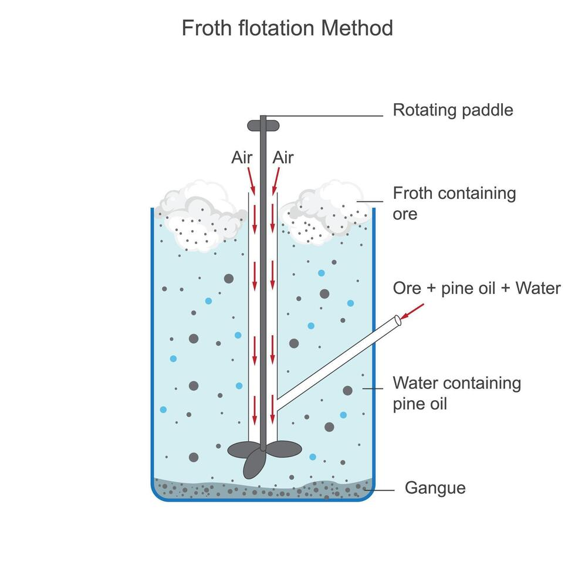

## i. Distinguish between (2 × 5 = 10 Marks)

### a) Co-polymer and Homopolymer

| Homopolymer                               | Co-polymer                                                     |
| ----------------------------------------- | -------------------------------------------------------------- |
| 1. Made from only one type of monomer.    | 1. Made from two or more different types of monomers.          |
| 2. Has a simple repeating structure.      | 2. Has different monomer units in its structure.               |
| 3. Properties are generally more uniform. | 3. Properties can be modified by changing monomer composition. |
| 4. Easier to produce.                     | 4. Generally requires more complex polymerisation.             |
| 5. Example: Polyethylene, PVC.            | 5. Example: Buna-S, Buna-N.                                    |

### b) Thermoplastic and Thermosetting Plastic

| Thermoplastic                                         | Thermosetting Plastic                                  |
| ----------------------------------------------------- | ------------------------------------------------------ |
| 1. Softens on heating and hardens on cooling.         | 1. Once hardened, cannot be softened again by heating. |
| 2. Can be remoulded and recycled.                     | 2. Cannot be remoulded easily.                         |
| 3. Has mostly linear or slightly branched structures. | 3. Has highly cross-linked structures.                 |
| 4. Generally less heat resistant.                     | 4. Generally more heat resistant.                      |
| 5. Examples: PVC, Polythene.                          | 5. Examples: Bakelite, Melamine.                       |

## ii. Explain the Froth-Flotation Method with a suitable diagram (5 Marks)

Definition:

Froth flotation is a method used to concentrate sulphide ores by separating them from impurities (gangue) based on differences in their surface properties.

Principle:

It works on the principle that sulphide ore particles are preferentially wetted by oil, whereas gangue particles are wetted by water.

Process:

1. The ore is crushed into fine powder and mixed with water to form a slurry.
    
2. A small amount of collector (pine oil) is added to the mixture.
    
3. Air is blown through the slurry with continuous agitation.
    
4. Sulphide ore particles attach to the air bubbles and rise to the surface as froth.
    
5. Gangue particles remain in water and settle at the bottom.
    
6. The froth is collected and dried to obtain concentrated ore.
    

Diagram:

``

Conclusion:

Thus, froth flotation is commonly used for concentrating sulphide ores such as zinc blende (ZnS) and copper pyrites (CuFeS₂).

